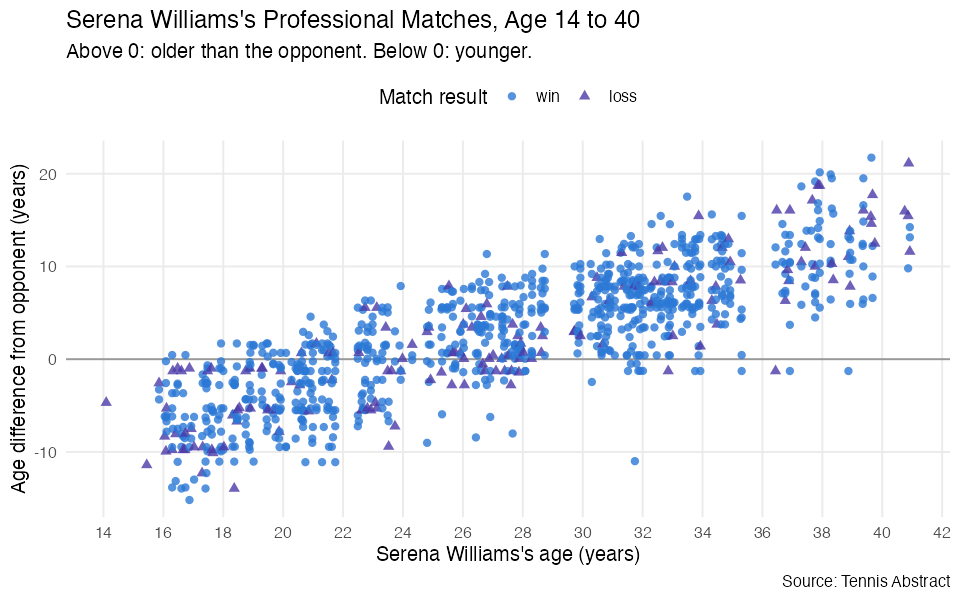

# tenniscareer

- Author: Minqi (Minchee) Yang
- Course: STAT 159, Fall 2026, UC Berkeley
- Start date: 2026-11-05

## Overview

`tenniscareer` is an R package for HW 3 of STAT 159. It has two public
functions. `get_player_matches()` downloads the career matches of a tennis
player from [Tennis Abstract](https://www.tennisabstract.com/) and returns a
clean data frame. `plot_age_gap()` draws the scatter plot of HW 2 from that
data frame: the age of the player against the age gap with the opponent,
colored by win or loss, without the annotations of the New York Times chart.

## Install

The package is not on CRAN. Install it from GitHub with `pak` or with
`devtools`:

```r
pak::pak("UCB-stat159-f26/hw03-3-minqiyang")

# or
devtools::install_github("UCB-stat159-f26/hw03-3-minqiyang")
```

## Use

```r
library(tenniscareer)

# Serena Williams: data and plot
serena <- get_player_matches("serena williams")
plot_age_gap(serena)

# Rafael Nadal: data and plot
rafa <- get_player_matches("Rafael Nadal")
plot_age_gap(rafa)

# An unknown player gives an error
get_player_matches("Gaston Sanchez")
#> Error: No career data found for "GastonSanchez" on tennisabstract.com.
#> Check the spelling of the name.
```

The plot of Serena Williams:



`get_player_matches()` accepts the name as `"serena williams"`,
`"Serena Williams"` or `"SerenaWilliams"`. It returns a data frame with one
row for each match and these columns:

| Column         | Meaning                                              |
| -------------- | ---------------------------------------------------- |
| `player`       | Full name of the player                              |
| `date`         | Date of the match                                    |
| `tournament`   | Name of the tournament                               |
| `surface`      | Court surface: `Hard`, `Clay`, `Grass` or `Carpet`   |
| `result`       | `"win"` or `"loss"`, for the player                  |
| `score`        | Score of the match                                   |
| `opponent`     | Full name of the opponent                            |
| `player_age`   | Age of the player on the date of the match, in years |
| `opponent_age` | Age of the opponent on that date, in years           |
| `age_diff`     | `player_age` minus `opponent_age`                    |

`plot_age_gap()` returns a `ggplot` object. Each point is one match. The
x-axis is the age of the player. The y-axis is the age of the player minus
the age of the opponent, so a point above the line at 0 is a match against a
younger opponent. The color and the shape of a point show if the player won
or lost.

## Data source

All data comes from [Tennis Abstract](https://www.tennisabstract.com/). For
one player the package downloads two files:

- The career file, for example
  [SerenaWilliamsCareer.js](https://www.tennisabstract.com/jsmatches/SerenaWilliamsCareer.js).
  It is a JavaScript file with one array for each match.
- The player page, for example
  [player.cgi?p=SerenaWilliams](https://www.tennisabstract.com/cgi-bin/player.cgi?p=SerenaWilliams).
  The package reads the full name and the date of birth of the player from it.

The career files of female and male players are different. A female file
gives the date of birth of the opponent, and the package computes the age
from it. A male file gives the age of the opponent directly. The package
looks at the file to tell the two cases apart.

An age in years is the number of days divided by 365.25. Walkovers (score
`W/O`) are removed, because the players did not play these matches. Matches
with no age for the opponent are removed too.

## Repository structure

```
hw03-3-minqiyang/
├── DESCRIPTION              # package name, version and dependencies
├── NAMESPACE                # exported functions, made by roxygen2
├── LICENSE                  # MIT license
├── README.md                # this file
├── instructions.md          # the homework instructions
├── R/                       # source code of the package
│   ├── get-player-matches.R # get_player_matches()
│   ├── plot-age-gap.R       # plot_age_gap() and its helpers
│   ├── player-name.R        # "serena williams" -> "SerenaWilliams"
│   ├── urls.R               # URLs of the career file and the player page
│   ├── fetch.R              # downloads, with retries
│   ├── parse-js.R           # reads the array of matches from the JS file
│   ├── player-profile.R     # reads the name and date of birth from the page
│   ├── ages.R               # age in years
│   ├── clean-matches.R      # builds the clean data frame
│   └── tenniscareer-package.R
├── man/                     # help pages, made by roxygen2
│   └── figures/             # the example plot of this README
└── tests/
    ├── testthat.R
    └── testthat/
        ├── fixtures/        # mock career files and a mock player page
        ├── helper-fixtures.R
        └── test-*.R         # unit tests
```

## Tests

The tests never connect to the internet. They use the mock files in
`tests/testthat/fixtures/` and replace the download step with fake
responses. Run them from the package folder with:

```r
devtools::test()
```

## Notes

- Some players have no career file on Tennis Abstract. For example,
  `get_player_matches("Carlos Alcaraz")` gives the "not found" error.
- Some career files stop early. The file of Rafael Nadal ends in 2016.
- Tennis Abstract slows down fast repeated requests. The package waits and
  tries again, up to 4 times in total, so a call can take a few seconds.
